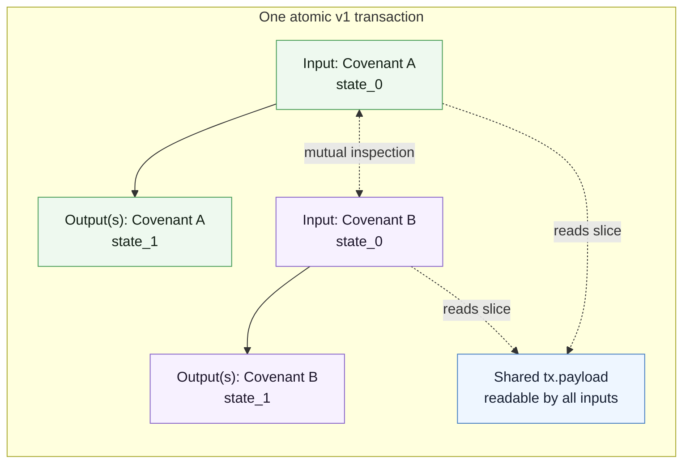
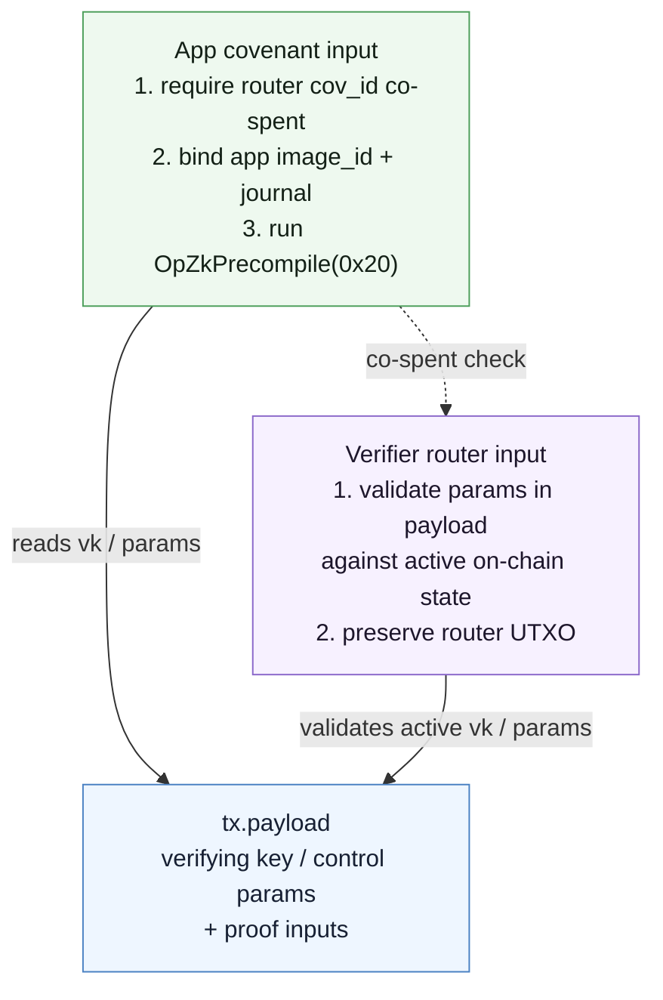

On an account-based chain, contracts compose through imperative calls: contract `A` invokes a method on contract `B`, and the VM executes `B`'s code inline. Kaspa's L1 covenant model works differently.

On Kaspa, independent covenants compose through **Inter-Covenant Communication (ICC)** — **co-spending in the same atomic transaction**. Every input script in the transaction executes and must succeed, or the entire transaction is rejected. Neither covenant runs the other's code; instead, each covenant validates its own transition and inspects the transaction to verify what its peer covenant is doing alongside it.



Four L1 primitives make this work cleanly without assuming any single covenant owns the whole transaction:

- **All-or-nothing transaction atomicity:** If any input script fails, none of the state transitions take effect.
- **Scoped family identity (`covenant_id`):** [KIP-20](./covenant-state#covenant-ids) tags inputs and outputs by covenant family, and `OpCovInput*` / `OpCovOutput*` let each script locate a peer covenant's exact slice of the transaction even when unrelated fee, change, or third-party covenant inputs are present.
- **Cross-input and output introspection:** Any input script can read other inputs' outpoints and script public keys, inspect outputs' values, scripts, and covenant bindings (`OpOutputCovenantId`, `OpOutputAuthorizingInput`), and verify preimages against P2SH hashes.
- **Shared transaction payload:** Every input script can inspect the same transaction `payload` via `OpTxPayloadLen` and `OpTxPayloadSubstr`, giving co-spent covenants an ephemeral shared channel for the duration of one transaction.

> [!NOTE]
> The main text on this page stays language-agnostic and describes L1 transaction mechanics directly. Color-coded snippet boxes illustrate each pattern across three tiers: **Silverscript · L1 Opcodes** (raw L1 script calls), **Argent · Implemented** (working [Argent](./argent) syntax today), and **Argent · Proposed Syntax** (design prototypes not yet implemented in the compiler).

## Five ICC patterns

Most cross-covenant interactions on Kaspa fall into five patterns, ordered from lightest coupling to richest shared interfaces.

| Pattern                                    | What the peer checks                                               | Typical use cases                                                    |
| ------------------------------------------ | ------------------------------------------------------------------ | -------------------------------------------------------------------- |
| Presence-only co-spend                     | Peer `covenant_id` appears among the transaction's inputs          | Covenant-owned custody (`KCC-2`), mint proxies, policy routers       |
| Closed state observation                   | Peer's exact known template and full input/output state transition | Tightly paired controller/asset apps, companion vaults               |
| Open interface observation                 | Agreed state prefix + pinned `(template_hash, covenant_id)`        | Permissionless DEXs, lending vaults, asset-agnostic settlement       |
| Payload-mediated channel & service queries | Structured slices / statements in the shared `tx.payload`          | Dynamic fee/policy hooks, shared oracle/KIP-21 verification, routers |
| Genesis-spawn composition                  | Recomputed KIP-20 genesis `covenant_id` of newly created outputs   | Factories, pair registries, market creators launching sub-apps       |

### 1. Presence-only co-spend (delegated authority)

The lightest form of composition is a **presence check**: covenant `A` stores the `covenant_id` of an authority covenant `B`, and allows a privileged transition whenever at least one valid input belonging to `B` participates in the same transaction (`OpCovInputCount(B) > 0`).

This gives a clean one-way dependency: `A` does not need to know `B`'s bytecode, state layout, or upgrade path. `A` simply delegates authorization to whoever can validly spend `B`. That is the exact mechanism behind [KCC-2's `covenant-id/v1` authority scheme](./kccs#kcc-2-authority-schemes), which lets a vault, order book, or DEX take custody of a [KCC-20](./kccs/kcc20) token UTXO.

> [!WARNING]
> **Presence is not authorization scope.** Knowing that `B` was validly spent in the same transaction does _not_ by itself tell `A` what `B` intended to authorize. If `B` has an unrelated spend path (for example, a routine fee rebalance, heartbeat, or admin action) that does not inspect `A`, an attacker can piggyback a spend of `A` onto that unrelated transaction of `B`. Sound delegation couples both sides: `B` must either inspect `A`'s transition, require a transaction-binding signature covering the spend, or restrict itself to a single dedicated authorization role.

<PatternSnippet
  status="argent"
  title="Co-spend custody check"
  sourceLabel="argent-playground/ag/dex/fixed_asset.ag"
  sourceHref="https://github.com/argent-lang/argent-playground/blob/master/ag/dex/fixed_asset.ag"
>

An asset actor delegates custody to an external covenant simply by requiring its owner `covenant_id` to be co-spent (lowering to `OpCovInputCount(owner) > 0`):

```rust
if (owner_kind == OWNER_KEY) {
    require(checkSig(owner_sig, pubkey(owner)));
} else if (owner_kind == OWNER_COVID) {
    // Valid only when the owning covenant family is spent in this tx.
    require(cov_id(owner).co_spent());
}
```

</PatternSnippet>

### 2. Closed state observation

When covenant `A` and covenant `B` are designed as known peers — for instance, a dedicated issuance controller paired with a token's mint proxy — `A` does not have to stop at presence. `A` can commit to `B`'s exact template bytecode and inspect `B`'s entire input and output group directly via `OpCovInput*` and `OpCovOutput*`.

Because `A` knows `B`'s exact script template, `A` can decode `B`'s current state from the spent input's script preimage, apply policy rules (such as remaining supply caps or governance checks), and verify that `B`'s successor outputs carry the exact next states `A` authorized. Both covenants stay in separate covenant families with independent `covenant_id`s, while still enforcing one joint atomic state transition.

<PatternSnippet
  status="argent"
  title="Closed observation of concrete peer actors"
  sourceLabel="argent/examples/icc/minter.ag"
  sourceHref="https://github.com/argent-lang/argent/blob/master/examples/icc/minter.ag"
>

A mint controller imports the compiled asset app's concrete actors (`KCC20Asset::MinterProxy`, `KCC20Asset::KCC20`) and constrains both observed inputs and outputs:

```rust
entry mint(sig owner_sig, byte[32] recipient_owner, int minted_amount)
observes asset by self.kcc20_covid {
    inputs  { proxy: KCC20Asset::MinterProxy }
    outputs { proxy: KCC20Asset::MinterProxy, recipient: KCC20Asset::KCC20 }
}
emits { controller: Minter } {
    MinterProxyState prev_proxy = state(asset.inputs.proxy);
    require(prev_proxy.controller_id == self.cov_id);
    require(amount >= minted_amount);

    MinterProxyState next_proxy = { controller_id: self.cov_id };
    KCC20State next_recipient = {
        owner_identifier: recipient_owner,
        identifier_type: IDENTIFIER_PUBKEY,
        amount: minted_amount,
    };

    // Constrain the observed asset family's exact successor outputs.
    require asset.outputs become {
        proxy <- KCC20Asset::MinterProxy(next_proxy),
        recipient <- KCC20Asset::KCC20(next_recipient),
    };
    // ... update controller's own remaining allowance ...
}
```

</PatternSnippet>

### 3. Open interface observation (implementation-agnostic composability)

Closed observation breaks down when a protocol — such as a DEX, lending pool, or auction house — needs to work uniformly with _many independently written contracts_ whose exact bytecode was not known when the observer was deployed.

Kaspa covenants support the verification equivalent of VM interfaces over state in two ways:

#### A. Agreed state layout (open state interfaces)

All conforming asset contracts expose the same fixed-width state prefix (for example, an owner, owner scheme, amount, and an opaque 32-byte digest for any implementation-specific extra state). The observer does not hardcode any asset's bytecode. Instead, for each supported asset, the observer stores only two 32-byte commitments:

1. the asset's **`covenant_id`** (identifying which live instance is real);
2. a stable **`template_hash`** (committing to the non-state bytecode prefix and suffix around the agreed state layout).

At spend time, the transaction supplies the asset's template bytes as an untrusted witness. The observer hashes those bytes against its stored `template_hash`, splices in the expected state fields, and verifies that the peer's spent input and successor outputs match the resulting P2SH commitments. The observer never executes the asset's code — the asset's own input script validates its internal rules in the same transaction, while the observer verifies the shared interface transition.

<PatternSnippet
  status="argent"
  title="Open interface observation with virtual state capsules"
  sourceLabel="argent-playground/ag/dex/"
  sourceHref="https://github.com/argent-lang/argent-playground/tree/master/ag/dex"
>

A shared `AssetCapsule` exposes the common fields while hiding asset-specific policy behind a `virtual` 32-byte digest. Concrete assets (`FixedToken`, `MintableToken`, `KasAsset`) expand `policy` independently, while `DexPair` stores only `(cov_id, actor_type<AssetCapsule>)` handles and swaps any conforming pair uniformly:

```rust
// Shared interface layout (capsule.ag)
state AssetCapsule {
    byte[32] owner;
    byte owner_kind;
    virtual policy; // opaque 32-byte digest to observers
    int amount;
}

// Concrete asset expands `policy` privately (fixed_asset.ag)
state FixedTokenState expands AssetCapsule {
    policy: FixedPolicy;
}

// Observer dispatches over stored handles without knowing concrete asset code (dex.ag)
entry swap()
observes quote by self.quote_id {
    inputs  { payment: self.quote_type } // actor_type<AssetCapsule>
    outputs { reserve: self.quote_type }
}
observes base by self.base_id {
    inputs  { reserve: self.base_type }
    outputs { payout:  self.base_type }
}
```

</PatternSnippet>

#### B. Operation receipts (note fields)

When observing an entire multi-input, multi-output transition would be verbose or expensive for an observer to reconstruct, a convention can add a designated **operation receipt** (or note) field to the peer's output state.

Instead of the observer iterating over every peer input and output to deduce what happened, the peer covenant writes a concise, standardized statement (or BLAKE3 digest of structured statements) into its receipt field — for example, committing to `"transferred X units from A to B"` — and the observer simply verifies that the peer output carries the expected receipt. This is the verification equivalent of an interface return value: the peer proves the operation locally and declares the result for any co-spent observer to check cheaply.

<PatternSnippet
  status="argent"
  title="Operation receipt field over standard observes"
>

A receipt field needs no dedicated language feature — it is a convention over an ordinary `byte[32]` state field written by the peer and constrained via standard `observes`:

```rust
// Peer actor commits a standardized receipt digest in its successor state:
byte[32] receipt = blake3(
    byte[](TAG_TRANSFER) + byte[](from) + byte[](to) + OpNum2Bin(amount, 8)
);
// become next <- Peer(next_peer); // with `last_op: receipt`

// Co-spent observer checks the declared receipt on the peer output
// without re-deriving conservation across every peer input and output:
byte[32] expected_op = blake3(
    byte[](TAG_TRANSFER) + byte[](buyer) + byte[](self.cov_id) + OpNum2Bin(price, 8)
);
PeerCapsule expected = { ..., last_op: expected_op };
require peer.outputs become { target <- self.peer_type(expected) };
```

</PatternSnippet>

### 4. Payload-mediated communication and dynamic dispatch

State observation works when the caller cares about _how a peer's state changed_. Sometimes, however, what a covenant wants from a peer is **an answer to a question about the current transaction**: _what fee rate applies to this swap? What is the authenticated oracle price or KIP-21 block timestamp? Is this withdrawal authorized under current policy?_

Every input script in a v1 transaction can inspect the same transaction `payload` via `OpTxPayloadLen` and `OpTxPayloadSubstr`. That turns `tx.payload` into an **ephemeral, read-only message bus** shared across all co-spent covenants for one transaction, enabling two closely related patterns:

- **Shared verification and witness deduplication:** One service input can verify expensive data once (a signed oracle report, a KIP-21 sequencing commitment opening, or shared settlement parameters) and expose the authenticated statement in `tx.payload` for multiple co-spent caller inputs to read without repeating the verification or witness bytes.
- **Verification-oriented dynamic dispatch ("propose the result, then verify it"):** Rather than calling a callee at runtime, the transaction composer places a structured **statement record** — `(method, arguments, proposed result)` — into the service input's section of `tx.payload`. Both sides verify the same bytes independently:
  - **The caller** resolves the service input (for example, the leader of a stored `covenant_id`), locates the statement inside that input's payload section, checks that the method and arguments match what it intended, and uses the proposed result in its own validation.
  - **The callee (service)** verifies its own section header and every statement in its section against its internal state, witnesses, and rules. Any entrypoint that does _not_ serve calls requires an **empty section** for its input, so an admin or housekeeping spend can run cleanly while rejecting any transaction that claims it served a call.

Because `tx.payload` is global to the transaction and Kaspa Script has no unbounded loops, independent contracts sharing a payload channel need a clean **framing convention** (for example, a versioned envelope prefix and a fixed-width section directory indexed by transaction input so callers jump directly to a statement and callees verify their full section within a known bound). See the [Kas-Smiths proposal on Inter-Covenant Communication with Dynamic Dispatch](https://kas-smiths.org/t/inter-covenant-communication-with-dynamic-dispatch/171) for the full design discussion.

<PatternSnippet
  status="silverscript"
  title="Shared payload section checks in raw Silverscript"
>

At the L1 script layer, both caller and service read the exact same transaction payload slices via `OpTxPayloadLen` and `OpTxPayloadSubstr` (assuming a fixed-width section directory indexed by input index):

```solidity
// --- Caller covenant (e.g. DEX pair asking a fee policy for a quote) ---
require(OpCovInputCount(fees_cov_id) > 0);
int service_in = OpCovInputIdx(fees_cov_id, 0);

// Read the service input's directory entry: [section_start (4B), section_len (4B)]
int dir_off = HEADER_LEN + service_in * 8;
require(OpTxPayloadLen() >= dir_off + 8);
int sec_start = OpBin2Num(OpTxPayloadSubstr(dir_off, dir_off + 4));
int sec_len   = OpBin2Num(OpTxPayloadSubstr(dir_off + 4, dir_off + 8));

// Verify the chosen statement record matches (METHOD_QUOTE, expected_args, fee_bps)
require(stmt_off >= sec_start && stmt_off + STMT_LEN <= sec_start + sec_len);
byte[] stmt = OpTxPayloadSubstr(stmt_off, stmt_off + STMT_LEN);
require(stmt == METHOD_QUOTE + expected_args + OpNum2Bin(fee_bps, 8));

// --- Service covenant (e.g. fee policy verifying its own input section) ---
int my_dir = HEADER_LEN + OpTxInputIndex() * 8;
require(OpTxPayloadLen() >= my_dir + 8);
int my_start = OpBin2Num(OpTxPayloadSubstr(my_dir, my_dir + 4));
int my_len   = OpBin2Num(OpTxPayloadSubstr(my_dir + 4, my_dir + 8));

// On a serving entry (1 statement): verify header + recompute the proposed result:
require(my_len == STMT_LEN);
require(OpTxPayloadLen() >= my_start + STMT_LEN);
byte[] served = OpTxPayloadSubstr(my_start, my_start + STMT_LEN);
require(served == METHOD_QUOTE + args_bytes + OpNum2Bin(computed_fee_bps, 8));

// On a non-serving entry (e.g. admin update): reject any claimed statements:
// require(my_len == 0);
```

</PatternSnippet>

<PatternSnippet
  status="prototype"
  title="Service interfaces and serve clauses"
  sourceLabel="kas-smiths.org/t/.../171"
  sourceHref="https://kas-smiths.org/t/inter-covenant-communication-with-dynamic-dispatch/171"
>

A proposed higher-level Argent surface would hide the payload directory plumbing behind typed `interface` declarations and unconditional `serve` assertions (not yet implemented in `argentc`):

```rust
interface SwapFee {
    fn quote(Reserves reserves, bool a_to_b, int amount) -> int;
}

// Inside the pair's swap entry, `fees_id` identifies its SwapFee provider.
int fee_bps = self.fees_id.quote(reserves, a_to_b, amount);
```

```rust
actor ImbalanceFees owns FeeState implements SwapFee {
    entry settle(QuoteWitness witness) {
        // Calculate the fee from the proposed swap and the policy's own state.
        serve SwapFee.quote as |reserves, a_to_b, amount| =>
            compute_fee(reserves, a_to_b, amount, volatility);
        // Check the policy's own continuation.
    }
}
```

An entry with two `serve` clauses would expect exactly two records in its payload section and verify both; an entry with no `serve` clause (such as an admin update) would automatically require an empty section (`my_len == 0`).

</PatternSnippet>

### 5. Genesis-spawn composition (atomic sub-app creation)

Factories, pair registries, and prediction-market creators often need to launch a brand-new child covenant family atomically inside a parent transition — and record the child's newly derived `covenant_id` in the parent's state.

As noted in [Covenant State](./covenant-state#auth-groups-and-covenant-groups), auth and covenant output groups (`OpAuthOutput*`, `OpCovOutput*`) exclude genesis outputs. Instead of scanning the entire transaction, the parent script accepts the global output indices of the child's initial outputs as untrusted witnesses, **recomputes the KIP-20 genesis `covenant_id` preimage on-chain** from its own outpoint plus those outputs' values and scripts, and checks that hash against `OpOutputCovenantId` on the first spawned output. Because consensus derives that output's `covenant_id` from the _complete_ ordered genesis output group, hash collision resistance proves in one check that no extra or altered outputs snuck into the spawned child family.

<PatternSnippet
  status="argent"
  title="Atomic child covenant launch with spawns"
  sourceLabel="argent/examples/spawns.ag"
  sourceHref="https://github.com/argent-lang/argent/blob/master/examples/spawns.ag"
>

`spawns` lowers to the on-chain KIP-20 genesis `covenant_id` recomputation and binds the derived `pair_id` so the parent can store or register it immediately:

```rust
entry launch(int left_amount, int right_amount)
spawns new_pair by pair_id {
    outputs {
        left: self.pair_type,
        right: self.pair_type,
    }
}
emits next: Controller {
    PairState left_state = { amount: left_amount };
    PairState right_state = { amount: right_amount };
    ControllerState next_state = { pair_type: pair_type, launches: launches + 1 };

    require new_pair.outputs become {
        left <- self.pair_type(left_state),
        right <- self.pair_type(right_state),
    };
    // `pair_id` is now authenticated as the exact genesis covenant_id
    // of those two outputs and can be saved in `next_state`.
    become next <- Controller(next_state);
}
```

</PatternSnippet>

## Worked example: shared service covenants and upgradable ZK routers

Combining **presence-only co-spend** and a **shared transaction payload** solves a practical problem for immutable covenants: how to stay immutable while delegating an evolving cryptographic or policy dependency to a separate, opt-in covenant.

Consider an application covenant that verifies BN254 Groth16 proofs via [`OpZkPrecompile(0x20)`](./inline-zk) (for example, a RISC Zero Groth16 verifier whose wrapper parameters can change after a prover SDK upgrade such as [GHSA-g6qg-9j8p-7j87](./inline-zk#risc-zero-advisory-and-remediation)). Hardcoding a verifying key or control root directly into every user UTXO forces a manual migration whenever proving parameters rotate.

With a **verifier router covenant**, the responsibilities split cleanly across two co-spent inputs:



1. **App covenant (immutable, holds user funds):** Opts into a specific router by storing the router's `covenant_id`. On spend, it checks that the router `covenant_id` is co-spent in the transaction, reads the verifying key / wrapper parameters from the agreed `tx.payload` slice, binds its own application `image_id` and state-transition journal, and runs `OpZkPrecompile(0x20)`.
2. **Verifier router covenant (shared service, holds no user funds):** Stores the currently active verifying key hash (or parameter commitment) in its own UTXO state. On spend, it checks that the payload parameters match its active state and recreates itself unchanged. Under its governance rule, it can rotate to patched parameters — immediately upgrading every app that opted into it without migrating user UTXOs.

Any shared service or router covenant must enforce two critical invariants:

- **No unvalidated spend paths:** Every spend path on the router covenant that preserves its `covenant_id` must either enforce parameter validation or require an empty payload section (as in the dynamic-dispatch pattern above). If a router had an unconstrained admin or housekeeping spend that ignored `tx.payload`, an attacker could co-spend the router during an admin transaction to bypass parameter checks.
- **Revocation across parallel replicas:** A single router UTXO serializes spends to one per block (~10/s), so busy routers will typically split into parallel replicas (the same expand-and-contract pattern used by [`PublicMint` and `TokenSeed`](./kccs/kcc20#expand-and-contract-frontiers-publicmint-and-tokenseed)). When revoking compromised parameters, governance must either replace every live replica or enforce epoch/time-bounded validity so stale replicas cannot remain spendable.

<PatternSnippet
  status="silverscript"
  title="Opt-in Groth16 verifier router via co-spend + payload"
>

Written directly with Silverscript's covenant, payload, and Groth16 builtins:

```solidity
// --- App covenant (immutable, holds user funds) ---
require(OpCovInputCount(router_cov_id) > 0);
require(OpTxPayloadLen() >= VK_LEN);
byte[] verifying_key = OpTxPayloadSubstr(0, VK_LEN);
g16.verify(verifying_key, proof, image_id, journal_digest);
// ... validate app successor output with new_root ...

// --- Verifier router covenant (shared service) ---
// Standard verify entrypoint:
require(OpTxPayloadLen() >= VK_LEN);
byte[] verifying_key = OpTxPayloadSubstr(0, VK_LEN);
require(blake3(verifying_key) == active_vk_hash);
// ... recreate router UTXO with identical active_vk_hash ...

// Admin rotation entrypoint (prevents piggyback verification during governance):
// require(OpTxPayloadLen() == 0);
```

</PatternSnippet>

## How the stack supports these patterns

Because every pattern above is built from native L1 transaction rules, you can adopt them at whichever layer fits your project:

| Layer                              | What it gives you                                                                                                             |
| ---------------------------------- | ----------------------------------------------------------------------------------------------------------------------------- |
| **[Silverscript](./silverscript)** | Direct access to `OpCov*`, `OpOutput*`, `OpTxPayloadLen` / `OpTxPayloadSubstr`, and `validateOutputState` for any pattern     |
| **[KCCs](./kccs)**                 | Standardized state layouts ([KCC-1](./kccs), [KCC-20](./kccs/kcc20)) and co-spend authority schemes (`covenant-id/v1`, KCC-2) |
| **[Argent](./argent)**             | Checked source-level abstractions for `.co_spent()`, closed/open `observes`, `actor_type<State>` capsules, and `spawns`       |

Continue with [Inline ZK](./inline-zk) for direct in-script proof verification, or inspect working open-ICC and multi-app demos in [`argent-lang/argent-playground`](https://github.com/argent-lang/argent-playground).
