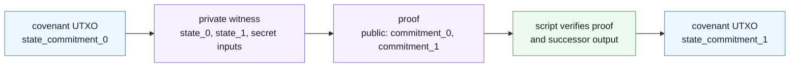
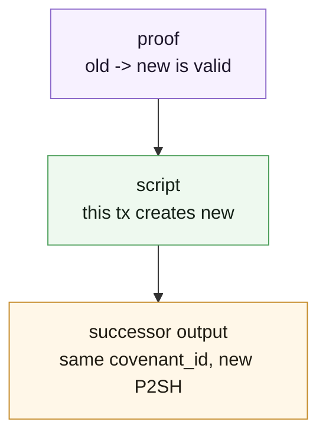
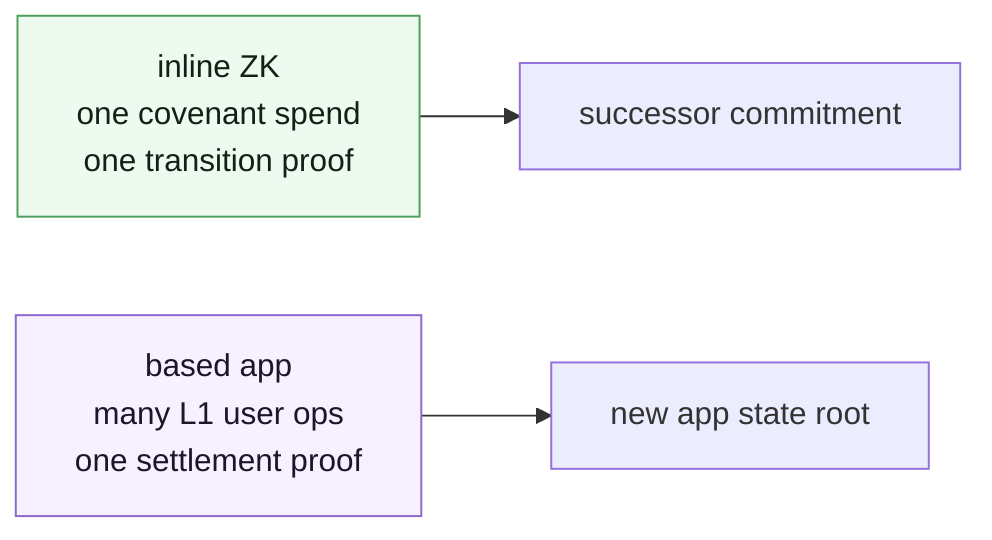

> [!CAUTION]
> **RISC Zero advisory ([GHSA-g6qg-9j8p-7j87](https://github.com/risc0/risc0/security/advisories/GHSA-g6qg-9j8p-7j87)):** Native RISC Zero STARK verification (tag `0x21`) is **unsound and deprecated — do not use it for new deployments**. Kaspa's generic BN254 Groth16 verifier (tag `0x20`), KAS, and all non-ZK transactions and covenants are unaffected. For RISC Zero covenants, use Groth16 (`0x20`) with `kaspa-txscript-zk-sdk >= 2.2.0` and `RISC Zero >= 3.1.0`. Read the full analysis in [What the RISC Zero Advisory Means for Kaspa's ZK Covenants](https://medium.com/@michaelsuttonil/what-the-risc-zero-advisory-means-for-kaspas-zk-covenants-e8cb067ea65b).

Inline ZK is still a covenant.

The covenant UTXO is spent. The script runs. The successor output is validated. The difference is that part of the transition happened elsewhere and arrives as a proof.



The L1 state can be a commitment instead of the full state. The transition function can run off-chain. The script only accepts the next UTXO if the proof binds the old commitment, the new commitment, and the exact program the covenant intended to use.

## What the proof buys

Without ZK, a covenant script has to execute the transition logic directly or inspect enough public data to validate it.

With inline ZK, the script can say:

```text
I will not rerun the transition.
I will verify that a specific proving program accepted it.
I will bind the proof output to my successor covenant state.
```

This changes where the work happens. The public script can stay small while the private or expensive check lives in the proof system.

It does not remove the covenant work. The script still has to validate the output it is creating.

## `OpZkPrecompile`

Toccata exposes proof verification through `OpZkPrecompile`.

The precompile dispatches by tag:

| Tag    | Proof system               | Status     | Shape                                                                                                                    |
| ------ | -------------------------- | ---------- | ------------------------------------------------------------------------------------------------------------------------ |
| `0x20` | Generic Groth16 (BN254)    | Active     | Compact BN254 proof; verifying key and public inputs come from script (not tied to RISC Zero; not post-quantum)          |
| `0x21` | RISC Zero Succinct (STARK) | Deprecated | Unsound due to consensus-pinned `4.0.4` recursion circuit; kept on-chain for legacy UTXO compatibility only — do not use |

The script should treat a proof as meaningful only under the exact verification key, image id, public inputs, and state commitments it expects. A proof that is valid for the wrong program is not useful to the covenant.

## RISC Zero advisory and remediation

On November 11, 2026, RISC Zero disclosed [GHSA-g6qg-9j8p-7j87](https://github.com/risc0/risc0/security/advisories/GHSA-g6qg-9j8p-7j87), a soundness flaw in its Groth16 wrapper and recursion circuit. The impact on Kaspa depends on which verification path an application uses:

- **Generic Groth16 (`0x20`) — consensus unaffected.** Kaspa's BN254 Groth16 precompile does not depend on RISC Zero; the spending script supplies the verifying key, proof, and public inputs. Non-RISC Zero Groth16 systems (Circom, Noir, SP1, custom circuits) are completely untouched. For RISC Zero Groth16 covenants, the STARK-to-Groth16 wrap happens off-chain, so fixing new deployments requires only upgrading to `kaspa-txscript-zk-sdk >= 2.2.0` ([`rusty-kaspa` PR #1176](https://github.com/kaspanet/rusty-kaspa/pull/1176)) and `RISC Zero >= 3.1.0` (`risc0-groth16 3.0.6`), then generating fresh proofs.
- **Native RISC Zero STARK (`0x21`) — unsound and deprecated.** In Toccata, Kaspa hardcoded RISC Zero's `4.0.4` recursion circuit and control root into consensus because carrying a ~70 KB circuit with each spend was impractical. That pins consensus verification to the affected rules. The precompile remains enabled on-chain solely so existing UTXOs stay spendable (backed by [`kaspa-r0-recursion-legacy`](https://github.com/kaspanet/kaspa-r0-recursion-legacy)), while its builders have been removed from `kaspa-txscript-zk-sdk 2.2.0` and `r0.succinct.verify` has been disabled in SilverScript `v1.0.2`. No hard fork or node upgrade is required; flexible native STARK verification is planned for a future hard fork.

**Builder action items:**

- **New deployments:** Use Groth16 (`0x20`). If proving with RISC Zero, use `kaspa-txscript-zk-sdk >= 2.2.0`, SilverScript `>= 1.0.2` (`r0.g16.verify`), and `RISC Zero >= 3.1.0`. Do not deploy new covenants using `0x21`.
- **Existing deployments:** Review any live UTXOs locked under affected RISC Zero Groth16 or STARK parameters and migrate funds or state through your application's recovery path. Spending existing legacy UTXOs remains consensus-valid using the prior SDK release.

## The covenant still owns the output

Inline ZK is a proof check inside the covenant loop.

```text
spend(proof, old_commitment, new_commitment, output_idx):
    require(old_commitment == current_state_commitment)
    require(zk_verify(program_id, proof, [old_commitment, new_commitment]))
    require(output[output_idx].covenant_id == current_covenant_id)
    require(output[output_idx].script_public_key == p2sh(contract, new_commitment))
```

The proof says the hidden transition is valid. The script says the transaction actually installs the proven next commitment.

Those are different checks. You need both.



## Where inline ZK fits

Inline ZK fits when each action can settle on its own:

- a private transfer covenant;
- a vault whose unlock condition depends on private data;
- a game or league covenant that checks a proprietary bot-detection predicate;
- a bridge-like covenant that verifies an external-state proof;
- a credential or membership predicate where the public chain should only see the accepted result.

The state transition may be private, expensive, or both. The public L1 state can stay as a hash.

## Where it stops fitting

Inline ZK becomes awkward when the app really wants a shared off-chain runtime.

Watch for these signs:

- many users mutate one shared state root;
- proofs should be batched over many user operations;
- exits are derived from a span of activity, not one covenant action;
- users should submit ordinary payload transactions instead of covenant spends;
- the app needs lane-local L1 ordering.

Those requirements move beyond "one covenant action, one proof." They point toward a based app.

## Inline ZK and based apps

Inline ZK and based apps share proof verification, but they use it at different scales.



Inline ZK is a local covenant technique. Based apps are an execution architecture.

Continue with [Based Apps](./based-apps).
