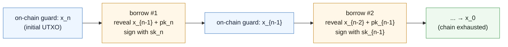
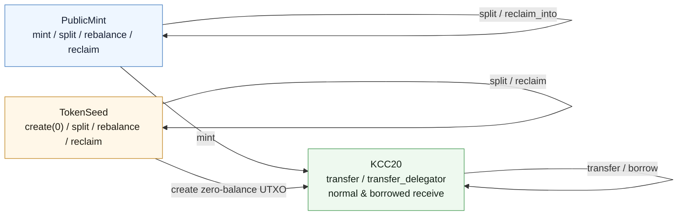

**[KCC-20](https://github.com/kaspanet/kccs/blob/main/kcc-0020.md)** (Final) is Kaspa's native L1 fungible-token covenant standard, built on [KIP-20](/programmability/covenant-state#covenant-ids), [KCC-1](/programmability/kccs#kcc-1-byte-layouts-and-program-abi), and [KCC-2](/programmability/kccs#kcc-2-authority-schemes).

Instead of relying on off-chain indexers to interpret raw data inscriptions, KCC-20 enforces token lineage, supply conservation, and ownership directly inside L1 consensus and script validation. Because KCC-20 supports KCC-2's `covenant-id/v1` owner scheme and a fixed-width state layout, DEXs, vaults, and prediction markets can hold and settle tokens atomically on L1.

<Cards>
  <Card
    title="KCC-20 Interactive Walkthrough"
    href="https://kcc20.manyfest.dev"
    description="Visual step-by-step walkthrough of KCC-20 token state, transfers, and borrowed receive."
  />
  <Card
    title="Hash-Chain Borrow Demo"
    href="https://kcc20.manyfest.dev/hash-chain"
    description="Interactive walkthrough of one-time hash-chain borrowed receive with front-running protection."
  />
  <Card
    title="argent-lang/kcc20-reference"
    href="https://github.com/argent-lang/kcc20-reference"
    description="Reference Argent app (KCC20, PublicMint, TokenSeed) with pinned .sil contracts and 22 VM conformance tests."
  />
  <Card
    title="KCC-20 Specification"
    href="https://github.com/kaspanet/kccs/blob/main/kcc-0020.md"
    description="Final specification, ABI definitions, and byte-for-byte conformance vectors on kaspanet/kccs (also on kccs.dev)."
  />
</Cards>

## State layout and transfer ABI

Every conforming KCC-20 UTXO exposes a fixed-width 112-byte `KCC20State` record:

| Field                  | Type       | Meaning                                                                                    |
| ---------------------- | ---------- | ------------------------------------------------------------------------------------------ |
| `amount`               | `int`      | Non-negative token quantity in base units (totals bounded within `2^63 - 1`)               |
| `owner`                | `byte[32]` | Owner identifier interpreted according to `owner_scheme`                                   |
| `owner_scheme`         | `byte`     | [KCC-2](/programmability/kccs#kcc-2-authority-schemes) authority scheme (`0x00`–`0x04`)    |
| `borrow_scheme`        | `byte`     | Borrowed-receive policy (`0x00`–`0x03`)                                                    |
| `borrow_guard`         | `byte[32]` | Scheme-specific guard (amount threshold, Schnorr pubkey, hash-chain commitment, or unused) |
| `extension_commitment` | `byte[32]` | Opaque 32-byte digest committing to optional application-specific extended state           |

Using fixed-width fields lets `next_states` encode cleanly as a KCC-1 record array and lets external covenants (such as an order-book DEX or prediction market) reuse the same decoding logic when inspecting KCC-20 inputs and outputs on-chain.

### Standard entrypoints

KCC-20 uses a leader/delegator pattern across all token inputs sharing the same KIP-20 `covenant_id`:

| Entrypoint                                           | Dispatch tag | Role                                                                                        |
| ---------------------------------------------------- | ------------ | ------------------------------------------------------------------------------------------- |
| `transfer(KCC20State[] next_states, byte[] witness)` | `79c71c23`   | Leader input: verifies its own owner (or borrow rule), supply conservation, and all outputs |
| `transfer_delegator(byte[] witness)`                 | `fd3ef14a`   | Every remaining token input: verifies only its own local owner authorization                |

The leader's `witness` starts with a 1-byte path selector: `0x00` for a normal owner-authorized transfer and `0x01` for a borrowed receive. Delegator witnesses carry owner authorization directly with no path selector.

### State extendability and fungibility

A KCC-20 token family can attach custom protocol logic (such as voting, vesting, or outcome-share rules) by committing extended state into `extension_commitment` and adding custom entrypoints alongside `transfer`.

Standard transfers treat `extension_commitment` as opaque and require every participating input and output to carry the exact same value. Within a KCC-20 covenant family, token UTXOs are **fungible if and only if their `extension_commitment` values match** — keeping the core `KCC20State` layout and `transfer` dispatch tag invariant across extensions.

## Borrowed receive

On a UTXO chain, paying tokens to a recipient normally creates a brand-new output funded with the sender's KAS (or leaves the recipient managing many small UTXOs). **Borrowed receive** lets a sender spend an existing recipient token UTXO _without the recipient's owner authorization_ — consolidating incoming tokens into that UTXO under a policy pre-approved by the recipient.

Every borrowed receive enforces strict safety invariants on the borrowed leader input and its successor at `next_states[0]`:

- `owner`, `owner_scheme`, `borrow_scheme`, and `extension_commitment` remain unchanged;
- the successor token `amount` strictly increases (above any threshold);
- the successor UTXO carries **at least as much KAS** as the borrowed input;
- all other token inputs still authenticate their owners via `transfer_delegator`.

### Borrow schemes

| Byte   | Scheme                 | `borrow_guard` (32 bytes)        | `borrow_witness` (`witness[1..]`)                                             |
| ------ | ---------------------- | -------------------------------- | ----------------------------------------------------------------------------- |
| `0x00` | `disabled/v1`          | Unused                           | Rejected                                                                      |
| `0x01` | `amount-threshold/v1`  | 8-byte LE threshold + padding    | Empty; incoming token increase must strictly exceed `max(threshold, 0)`       |
| `0x02` | `schnorr-signature/v1` | 32-byte Schnorr pubkey           | 65-byte Schnorr transaction signature under `borrow_guard`                    |
| `0x03` | `hash-chain/v1`        | Current 32-byte chain commitment | 129 bytes: `next_borrow_guard` (32 B), `one_time_pubkey` (32 B), `sig` (65 B) |

### Hash-chain borrowed receive (`0x03`)

`hash-chain/v1` lets a recipient issue a sequence of **single-use receive authorizations** while keeping only a single 32-byte commitment (`x_n`) on-chain. To prepare a chain of `n` borrows, the recipient chooses a random seed `x_0` and `n` one-time Schnorr keypairs, then hashes forward:

```text
x_i = BLAKE3(x_{i-1} || pubkey_i)    for i = 1..n
```

The initial on-chain `borrow_guard` is `x_n`. Authorizations are released in reverse order (`x_{n-1}` down to `x_0`), so each link can be used at most once and the chain is exhausted after `x_0` is revealed.

Binding a fresh one-time Schnorr key into every link prevents mempool front-running: if a link were only a plain hash preimage, a mempool observer could copy the revealed preimage from an unconfirmed transaction and front-run the borrow with a dust payment. To borrow against guard `x_i`, the sender reveals `x_{i-1}` and `pubkey_i`, signs the spending transaction with `private_key_i`, and sets `next_states[0].borrow_guard` to `x_{i-1}`. Because the signature binds the authorization to that specific transaction and the guard advances on-chain, links cannot be replayed or stolen in the mempool.



Explore this flow step-by-step in the **[Hash-Chain Borrow Demo](https://kcc20.manyfest.dev/hash-chain)**.

## Reference implementation (`argent-lang/kcc20-reference`)

[`argent-lang/kcc20-reference`](https://github.com/argent-lang/kcc20-reference) is the reference KCC-20 implementation written in [Argent](/programmability/argent). It implements the standard `KCC20` actor (1–3 inputs, 1–3 outputs, all five KCC-2 owner schemes, and all four borrow schemes) inside a complete `KCC20PublicMint` app composed of three cooperating actors sharing one KIP-20 `covenant_id`:



### Expand-and-contract frontiers (`PublicMint` and `TokenSeed`)

Both `PublicMint` and `TokenSeed` demonstrate a core Kaspa UTXO scaling pattern — **expand-and-contract frontiers**:

- **Scaling out under demand:** Anyone can call `PublicMint::split(take, new_owner)` (moving up to half a minter's remaining allowance into a second minter) or `TokenSeed::split(new_owner)` by locking a small KAS deposit for the new UTXO. Parallel minters and seeds eliminate single-UTXO contention during hot launches.
- **Reclaiming KAS when demand cools:** Deposit owners can adjust deposits via `rebalance_value(owner_signature)`, merge a retiring minter's allowance into a surviving minter (`reclaim_into`), close an exhausted minter (`reclaim`), or retire excess seeds (`reclaim`, always preserving at least one live seed) to recover their locked KAS.
- **Zero-balance receiving UTXOs:** `TokenSeed::create(recipient_state)` lets anyone opt into a token family by creating a zero-token UTXO funded with their own KAS and chosen borrow policy. Senders can then borrow-send tokens into that UTXO without contributing KAS of their own.

### Genesis deployment and verification

When deploying `KCC20PublicMint`, create the initial `PublicMint` (carrying the advertised total supply) and at least one `TokenSeed` (sharing the same `extension_commitment`) in the **same genesis output group** so they share one `covenant_id` — seeds cannot be added after genesis. Verifying the genesis group confirms the advertised supply cap and confirms that seeding is enabled (see [Argent genesis proofs](/programmability/argent#tooling-runtime-and-genesis-proofs)).

### Artifacts, conformance vectors, and local runs

The repository commits pinned build outputs under `fixtures/public-mint/` (`kcc20.json`, `artifact.json`, `manifest.json`, and generated `sil/{KCC20,PublicMint,TokenSeed}.sil`) so contract and compiler changes are directly reviewable in Git.

Its test suite executes malformed and valid transactions directly in the covenant VM (without relying on a transaction builder to filter edge cases) and runs the KCC-20 specification vectors from `fixtures/kcc20/conformance.json` — checking ABI, encoding, and hash vectors byte for byte alongside all **22** transfer and borrowed-receive VM cases. Note that these offline tests do not exercise live network submission or wallet synchronization and are not an independent third-party security audit.

```bash
# Run offline threshold-borrow, hash-chain borrow, and public-mint examples
cargo run --locked --bin kcc20
cargo run --locked --bin kcc20 -- hash-chain
cargo run --locked --bin kcc20 -- mint

# Run full VM and ABI test suite + 22 KCC-20 conformance vectors
cargo test --locked --all-targets
cargo test --locked --all-targets conformance_ -- --nocapture
```

## Building with KCC-20

How you adopt KCC-20 depends on whether you are launching a token, building a wallet, or composing with tokens inside another covenant:

### Launching or extending a token

Suppose you are launching a fixed-supply token — or an application token with extra rules such as voting or redemption:

1. **Start from [`kcc20-reference`](https://github.com/argent-lang/kcc20-reference):** Reuse the `KCC20` actor (preserving the 112-byte `KCC20State`, `transfer`, and `transfer_delegator` ABI) and pair it with `PublicMint` and `TokenSeed`, or swap in your own issuer/vault actor.
2. **Keep custom logic out of the transfer ABI:** Commit any app-specific per-UTXO state into `extension_commitment` and expose custom entrypoints alongside `transfer`, so wallets and DEXs can still move your token with standard KCC-20 tooling.
3. **Launch and publish artifacts:** Deploy the initial issuer and seed outputs in one genesis output group to fix the KIP-20 `covenant_id`, publish `kcc20.json`, `artifact.json`, and a genesis proof (`argentc genesis compose`), and verify the generated `.sil` against the 22 KCC-20 conformance vectors.

### Integrating KCC-20 in wallets and protocols

Suppose you are building a wallet or a covenant DEX that supports arbitrary KCC-20 tokens:

1. **Discover and verify the token:** Load the token's KCC-1/KCC-20 Program ABI artifact (for example, `kcc20.json` and sibling `artifact.json` in `kcc20-reference`), verify its genesis provenance against the on-chain `covenant_id`, and read its configured transfer entrypoints, supported owner schemes, and input/output bounds.
2. **Wallets:** Index live UTXOs by `covenant_id`, construct transfer spends using the token's declared leader/delegator entrypoints (`transfer` and `transfer_delegator` by default), and optionally fund a zero-balance receiving UTXO (such as via `TokenSeed::create` in `kcc20-reference`) with a `hash-chain/v1` or `amount-threshold/v1` guard so senders can borrow-send into it without supplying KAS.
3. **Covenant protocols (e.g., DEXs or vaults):** Whitelist each token by its `(template_hash, covenant_id)` pair, confirm its declared owner schemes include KCC-2's `covenant-id/v1` before taking covenant custody, and inspect the fixed-width 112-byte `KCC20State` on co-spent inputs and outputs to settle trades atomically on L1.

Continue to [Inter-Covenant Communication (ICC)](/programmability/composability) to see how tokens and external protocols compose atomically on L1, or jump to [Inline ZK](/programmability/inline-zk) for direct proof verification inside covenants.
