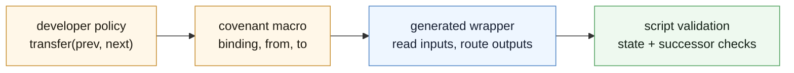
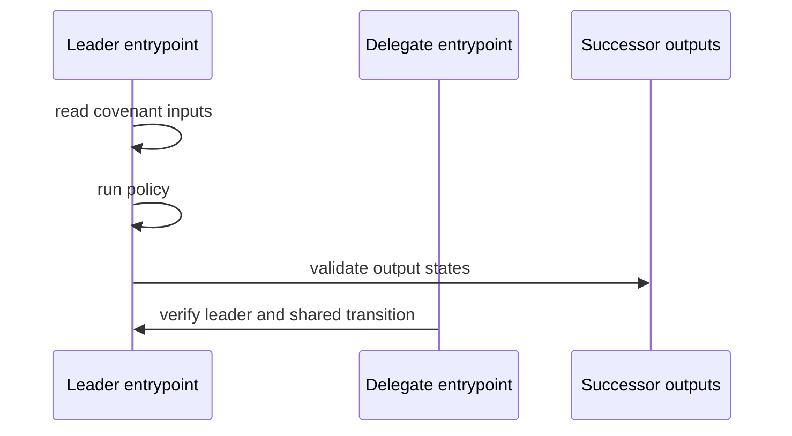

Silverscript is the language and compiler for Toccata L1 covenants. You write contract state and transition policy; the compiler handles stack encoding, portable ABI layout, state-validation helpers, and repetitive covenant plumbing so you do not have to manage raw Kaspa script by hand. For multi-contract and multi-app covenant systems, [Argent](./argent) builds directly on top of Silverscript and compiles down to plain, auditable `.sil` contracts.

Silverscript is released for production use via crates.io (`silverscript-lang`, `silverscript-abi`, `silverscript-cli-debugger`) and the [latest Silverscript release](https://github.com/kaspanet/silverscript/releases/latest).

## Per-UTXO state in Silverscript

Start with a scheduled-withdrawal KAS vault that releases at most `max_withdraw` sompi per interval and advances `next_unlock` on every withdrawal:

```js
pragma silverscript ^0.1.0;

contract Vault(pubkey pk, temporal interval, int max_withdraw, temporal init_next_unlock) {
    temporal next_unlock = init_next_unlock;            // <- per-UTXO state field

    entry withdraw(sig s, int amount) {
        require(tx.time >= next_unlock);                // unlock time reached
        require(amount > 0 && amount <= max_withdraw);  // within withdrawal cap
        require(checkSig(s, pk));                       // owner authorization
        require(tx.outputs[0].value == tx.inputs[this.activeInputIndex].value - amount); // keep remaining KAS

        State next_state = State { next_unlock: next_unlock + interval };   // advance unlock slot
        validateOutputState(0, next_state);                                 // enforce successor output
    }
}
```

When writing Silverscript, think of contract fields (`next_unlock`) as **per-UTXO storage slots**. At the compiler level, all constructor arguments supply compile-time values when `silverc` builds the contract artifact:

- Arguments referenced inside contract logic (`pk`, `interval`, `max_withdraw`) are baked into the contract template body and stay fixed for that compiled template.
- State fields (`next_unlock`) live in the leading **state prefix** described by the compiled ABI artifact. An argument used only to initialize a state field (`init_next_unlock`) sets its initial value; once compiled, tooling can instantiate or update state fields in that prefix **without recompiling**.

Notice that this vault uses a plain `entry` and `validateOutputState(0, next_state)` with **no [KIP-20 covenant ID](./covenant-state#covenant-ids)**. Because native KAS scarcity is already enforced by L1 consensus, someone cloning the same script over their own KAS cannot affect your vault. You only need KIP-20 covenant IDs when managing scarce application-level resources outside KAS consensus (such as tokens, tickets, or protocol registries).

Technically, there is no mutable storage inside a Kaspa node: each state field is encoded in the current UTXO's redeem-script preimage, and `validateOutputState` checks that output `0` commits to the same contract template with the updated state prefix (see [Covenant State](./covenant-state)).

Silverscript lets you focus on:

```text
old state + arguments + transaction facts -> allowed new state
```

instead of manually assembling:

```text
stack layout + introspection opcodes + P2SH reconstruction + covenant bindings
```

## Language highlights

Silverscript provides the typed primitives needed for safe covenant authoring:

- **Entrypoints and dispatch tags:** Public spend paths use the `entry` keyword and compile to deterministic 4-byte BLAKE3 signature-based dispatch tags (`DispatchTag`), aligned with KCC-1.
- **Separate time and DAA lock domains:** Wall-clock locks (`tx.time`) require the `temporal` type (Unix milliseconds), while absolute and relative DAA locks (`tx.daa`, `this.ageDaa`) take `int` — preventing accidental mixing of timestamps and DAA scores.
- **Signatures and hashing:** `checkSig`, `checkSigEcdsa`, `checkMsgSig`, `checkMsgSigEcdsa`, `blake3`, `blake3WithKey`, `blake2b`, `blake2bWithKey`, `sha256`, and BLAKE3 `templateHash`.
- **Explicit conversions:** Fixed-width byte casts (`x as byte[N]`), `bool as int`, and explicit `signed(byte)` / `unsigned(byte)` conversions.
- **Transaction introspection:** High-level transaction fields alongside covenant opcodes:

```js
require(tx.outputs[0].value == tx.inputs[this.activeInputIndex].value);

byte[32] cov_id = OpInputCovenantId(this.activeInputIndex);
int in_count = OpCovInputCount(cov_id);
int out_idx = OpAuthOutputIdx(this.activeInputIndex, 0);
```

## Covenant macros

When a contract manages scarce application-level resources outside KAS consensus — such as fungible tokens, tickets, or shared protocol state — you need KIP-20 covenant IDs so nobody can mint counterfeit UTXOs with forged initial state, alongside consistent transaction-layout checks across inputs and outputs.

Silverscript covenant declarations automate that boilerplate for **a single contract template under one KIP-20 covenant ID**.

> [!NOTE]
> **Why macros assume one template per covenant ID:** Generated `binding = cov` wrappers locate peer inputs via `OpCovInputIdx(cov_id, k)` and read their state without checking peer templates. Safety relies on induction from genesis via `covenant_id`: every UTXO under that ID must share the same contract template (and macros always require covenant IDs even when a contract would not strictly need one). For multiple cooperating templates under one covenant ID, use [Argent](./argent).

Declare the transition policy and let the compiler generate the surrounding wrapper:

```js
contract Token(int max_ins, int max_outs, int init_amount, pubkey init_owner) {
    int amount = init_amount;
    pubkey owner = init_owner;

    #[covenant(binding = cov, from = max_ins, to = max_outs)]
    function transfer(State[] prev, State[] next, sig s) {
        require(checkSig(s, owner)); // authorize leader input

        int sum = 0;
        for(i, 0, prev.length, max_ins) { sum = sum + prev[i].amount; }
        for(i, 0, next.length, max_outs) {
            require(next[i].amount > 0);
            sum = sum - next[i].amount;
        }
        require(sum == 0);
    }

    #[covenant.delegate]
    function auth_delegate(sig s) { require(checkSig(s, owner)); } // authorize each delegate
}
```

The policy enforces conservation; the macro generates the surrounding covenant group checks, leader/delegate entrypoints, and successor output validation.



Shorthand aliases cover common topologies:

- `#[covenant.singleton]` — equivalent to `#[covenant(from = 1, to = 1)]`
- `#[covenant.fanout(to = Y)]` — equivalent to `#[covenant(from = 1, to = Y)]`
- `#[covenant.delegate]` — defines the shared authorization body for delegate inputs in a `binding = cov` leader contract
- `#[covenant.allow(rule = manual_entrypoint_in_leader_contract)]` — explicit opt-in when adding a handwritten `entry` alongside `binding = cov` declarations

See [`DECL.md`](https://github.com/kaspanet/silverscript/blob/master/docs/DECL.md) for the complete covenant declaration specification.

## Auth binding and cov binding

Two transaction views come up constantly.

Use **auth binding** (`binding = auth`, default when `from == 1`) when the active input authorizes its own successors:

```js
#[covenant.fanout(to = max_outs)]
function split(State prev_state, State[] new_states) {
    require(new_states.length > 0);
}
```

The generated code inspects:

```text
OpAuthOutputCount(active_input)
OpAuthOutputIdx(active_input, k)
```

Use **cov binding** (`binding = cov`, default when `from > 1`) when a transition spans multiple inputs and outputs sharing the same covenant ID:

```js
#[covenant(binding = cov, from = max_ins, to = max_outs)]
function merge(State[] prev_states, State[] new_states) {
    require(new_states.length == 1);
}
```

The generated code inspects the shared covenant context:

```text
OpInputCovenantId(active_input)
OpCovInputCount(cov_id)
OpCovInputIdx(cov_id, k)
OpCovOutputCount(cov_id)
OpCovOutputIdx(cov_id, k)
```

Auth binding asks _"what did this input authorize?"_ Cov binding asks _"what belongs to this covenant family in this transaction?"_

## Leader and delegate lowering

For many-input transitions, one input leads while peers delegate:



The leader does the heavy work: reading peer states, running the policy, and validating successor outputs. Delegates verify their own authorization (via `#[covenant.delegate]`) and confirm that a valid leader is taking responsibility for the transition.

## Foreign templates

Multi-contract apps need one contract to read or validate another contract's state. Silverscript exposes template-aware state builtins for that pattern:

- `readInputState` and `readInputStateWithTemplate`
- `validateOutputState`, `validateOutputStateWithTemplate`, and `validateOutputStateWithInputTemplate`

```js
validateOutputStateWithTemplate(
  output_idx,
  next_player,
  player_prefix,
  player_suffix,
  player_template,
);
```

Each check verifies that the output state is encoded under the expected template (`template prefix + state bytes + template suffix`), not merely that some output exists. When an application grows beyond one or two templates, [Argent](./argent) automates this routing and lowers directly to plain Silverscript using these builtins.

## Covenant-native ownership

Toccata ownership is not limited to public-key signatures. Standardized under [KCC-2](https://github.com/kaspanet/kccs/blob/main/kcc-0002.md) (Final), covenants can accept five canonical authority schemes:

| Byte   | Scheme             | How authorization is verified                                      |
| ------ | ------------------ | ------------------------------------------------------------------ |
| `0x00` | `p2pk-schnorr/v1`  | Schnorr signature directly against the 32-byte pubkey              |
| `0x01` | `p2pkh-schnorr/v1` | Reveal pubkey matching `BLAKE3(pubkey)` + Schnorr signature        |
| `0x02` | `p2pkh-ecdsa/v1`   | Reveal 33-byte compressed pubkey matching `BLAKE3(pubkey)` + ECDSA |
| `0x03` | `p2sh/v1`          | Co-spent input whose script public key matches the BLAKE2b P2SH    |
| `0x04` | `covenant-id/v1`   | Co-spent input carrying the authenticated KIP-20 `covenant_id`     |

The `covenant-id/v1` scheme is key to UTXO-native composability: a covenant can own tokens or assets as a covenant identity, allowing atomic cross-covenant flows without keys.

## ZK verification builtins

Silverscript exposes direct Groth16 verification through `g16.verify` (generic BN254 Groth16, unaffected by the RISC Zero advisory) and `r0.g16.verify` (updated in Silverscript `v1.0.2` to `kaspa-txscript-zk-sdk 2.2.0` / `RISC Zero 3.1.0`). The native STARK builtin `r0.succinct.verify` is disabled at compile time in `v1.0.2` due to [GHSA-g6qg-9j8p-7j87](https://github.com/risc0/risc0/security/advisories/GHSA-g6qg-9j8p-7j87); see [Inline ZK](./inline-zk#risc-zero-advisory-and-remediation).

## Tooling and workflow

The [`kaspanet/silverscript`](https://github.com/kaspanet/silverscript) workspace provides:

- **`silverc`** (`silverscript-lang`): compiles `.sil` contracts to portable JSON artifacts (`--constructor-args`, `-o FILE.json`, `-c/--stdout`, `--ast-only`).
- **`silverscript-abi`**: portable ABI schema v1 (`SIL_ABI_SCHEMA_VERSION = 1`), codecs, `DispatchTag`, `ArtifactValue`, and `check_consistency()` validation.
- **`silverscript-cli-debugger`** (`debugger/cli` + `debugger/session`): interactive and `.test.json` batch source-level debugger.
- **Editor support**: `silverscript-tree-sitter` grammar plus extensions for VS Code, Zed, and Neovim under `extensions/`.
- **Guides**: [`TUTORIAL.md`](https://github.com/kaspanet/silverscript/blob/master/docs/TUTORIAL.md), [`DECL.md`](https://github.com/kaspanet/silverscript/blob/master/docs/DECL.md), [`CONSTRUCTOR_ARGS.md`](https://github.com/kaspanet/silverscript/blob/master/docs/CONSTRUCTOR_ARGS.md), and the hosted [Fungible Token Book](https://kaspanet.github.io/silverscript/fungible-token-book/).

Useful local commands:

```bash
cargo test -p silverscript-lang
cargo run -p silverscript-lang --bin silverc -- contract.sil -o artifact.json
cargo run -p silverscript-cli-debugger -- \
  silverscript-lang/tests/examples/if_statement.sil \
  --function hello --ctor-arg 3 --ctor-arg 10 --arg 1 --arg 2
```

## What to tell an agent

When using coding agents for Silverscript contracts, give them the covenant design before asking for code:

- inspect the [latest Silverscript release](https://github.com/kaspanet/silverscript/releases/latest) / `silverscript-lang` crate and docs for exact language syntax;
- identify whether the transition is `1:1`, `1:N`, `N:M`, leader/delegate, or multi-contract (and consider [Argent](./argent) once multiple templates interact);
- validate successor outputs, not only old inputs;
- use covenant IDs for lineage, without confusing them with transition validation;
- use `g16.verify` / `r0.g16.verify` for ZK checks — never deprecated `r0.succinct.verify`;
- keep state small enough for script limits and transaction mass.

Continue with [Argent](./argent) for multi-contract actors, inter-covenant communication, and launch proofs.
